# 🛡️ Awesome-Managed-Threat-Hunting

  

  
  
  
  
  
  

---

## 🎯 Top Managed Threat Hunting Ecosystem & MDR Directory

> 🔍 **A curated list of elite SaaS Managed Detection & Response (MDR) platforms, 24/7 human-led threat hunting services, and battle-tested open-source hunting security tooling.**

Welcome to the definitive threat hunting knowledge hub. This repository catalogues the leading commercial enterprise solutions and community open-source frameworks powering modern Security Operations Centers (SOCs), incident response teams, and adversary hunting operations across endpoint, identity, cloud, and network attack surfaces.

---

## 📑 Table of Contents

- [📊 Sector Overview & Market Dynamics](#-sector-overview--market-dynamics)
- [🏢 SaaS & Hosted Commercial MDR Platforms](#-saas--hosted-commercial-mdr-platforms)
- [💻 Open-Source Threat Hunting Tools & Frameworks](#-open-source-threat-hunting-tools--frameworks)
  - [⭐ Open-Source Repositories Ranked by Stars](#-open-source-repositories-ranked-by-stars)
  - [🛠️ Tooling Categories & Framework Architecture](#️-tooling-categories--framework-architecture)
- [🤝 How to Contribute](#-how-to-contribute)
- [💖 Support](#-support)
- [📈 Star History](#-star-history)
- [⚠️ Disclaimer](#️-disclaimer)

---

## 📊 Sector Overview & Market Dynamics

The global **Managed Detection and Response (MDR)** and **Threat Hunting** market is currently estimated between **$5.0B and $6.2B**, expanding rapidly at a Compound Annual Growth Rate (**CAGR of 18% to 23%**) toward an estimated **$15B to $25B** over the next decade. 

The sector exhibits **moderate fragmentation**:
- **Technology & Telemetry Layer**: Heavily dominated by XDR and EDR platform giants (CrowdStrike, SentinelOne, Microsoft Defender, Google SecOps) capturing core telemetry.
- **Service & Operations Layer**: Highly dispersed among dedicated MDR vendors, pure-play threat intelligence specialists, and regional Managed Security Service Providers (MSSPs) providing dedicated 24/7/365 human SOC analysts, reverse engineering, and threat containment.

---

## 🏢 SaaS & Hosted Commercial MDR Platforms

Below is the comparative breakdown of the top commercial managed threat hunting and MDR providers, ordered by company valuation and market capitalization:

| Platform | Valuation / Revenue | Starting Pricing | Free Tier / Free Trial Limits | Description |
|---|---|---|---|---|
| **[CrowdStrike Falcon OverWatch](https://www.crowdstrike.com/)** | ~$85B–$100B+ Market Cap | From $184.99/device/year ($19.99/device/month) for Falcon Enterprise (bundled with OverWatch hunting); MDR add-on from ~$42/endpoint/month | 15-day free trial (up to 50 endpoints with full Falcon platform functionality) | Proactive managed threat hunting across Falcon endpoint telemetry where human elite hunters hunt 24/7 and deliver actionable escalations. |
| **[SentinelOne Vigilance](https://www.sentinelone.com/)** | ~$8.5B Market Cap | Vigilance MDR add-on from ~$15–$50/endpoint/year (layered on Singularity Complete at ~$180/endpoint/year; combined ~$15–$20/endpoint/month) | 30-day proof-of-concept / evaluation trial (guided evaluation with full autonomous EDR & hunting access) | 24/7 managed threat hunting and triage add-on to Singularity XDR/EDR, responding and neutralizing threats on behalf of customers. |
| **[Mandiant Managed Defense](https://www.mandiant.com/)** | $5.4B (Acquired by Google) | Starting tier from ~$80,000–$90,000/year for enterprise baseline environments | No free trial for Managed Defense (human SOC service); 14-day trials available for standalone Mandiant Threat Intelligence & Attack Surface modules | Premier front-line MDR service backed by Mandiant incident responders and Google SecOps, integrating third-party EDR telemetry with proprietary adversary intel. |
| **[Arctic Wolf](https://arcticwolf.com/)** | $4.3B Valuation | From $44,000/year (MDR Basic for up to 100 users, ~$36.67/user/month); volume tiers at ~$190–$260/user/year | No self-service free trial; vendor-led technical scoping, architecture evaluation, and live customized SOC demo | Concierge Security Team delivery model providing 24/7 monitoring, managed threat hunting, log retention, and strategic risk guidance. |
| **[Sophos Managed Threat Response](https://www.sophos.com/)** | $3.9B (Acquired by Thoma Bravo; >$1B Rev) | From ~$240/endpoint/year (~$20/endpoint/month) for Sophos MDR Complete; MDR Essentials entry at ~$170/endpoint/year | 30-day free trial (full access to Sophos Central management, Intercept X Advanced with XDR) | 24/7 human-led threat hunting, investigation, and neutralization service natively integrated with Sophos endpoint, firewall, and identity products. |
| **[Huntress](https://www.huntress.com/)** | $1.55B Valuation | From $8.99/endpoint/month for Managed EDR (~$7.00–$7.99/endpoint/month at standard mid-tier volume) | 14-day free trial (full-featured unlimited endpoint deployment for Managed EDR/ITDR/SIEM; 21 days for SAT) | Human-led MDR designed for mid-market and MSPs, pairing lightweight agent detection with 24/7 human threat hunter investigation and remediation playbooks. |
| **[eSentire MDR](https://www.esentire.com/)** | $1.1B Valuation | From ~$60–$100/endpoint/year for smaller deployments (50–200 endpoints); drops to ~$40–$80/endpoint/year at scale | No self-service free trial; live proof-of-value (POV) and interactive threat investigation demo | 24/7 multi-signal Managed Detection and Response focusing on rapid human-led threat containment, ATLAS AI curation, and embedded DFIR capabilities. |
| **[Rapid7 Managed Threat Complete](https://www.rapid7.com/)** | ~$850M Market Cap (~$850M ARR) | From ~$15–$22/asset/month (typically structured around a 500-asset baseline minimum, starting ~$73,000–$90,000/year) | 30-day free trial (available for underlying InsightIDR SIEM/XDR and InsightVM platforms) | End-to-end MDR bundling InsightIDR cloud SIEM, unlimited InsightVM vulnerability management, and 24/7 SOC threat hunting. |
| **[Secureworks Taegis](https://www.secureworks.com/)** | $859M (Acquired by Sophos) | Managed XDR/MDR from ~$100–$130/endpoint/year (standalone Taegis XDR platform entry at ~$43,000/year for ~1,000 endpoints) | 14-day free trial (Taegis XDR evaluation tenant supporting limited host agents and cloud telemetry connectors) | Open XDR architecture with managed detection, adversary threat hunting, and comprehensive cross-vendor telemetry correlation. |
| **[Red Canary MDR](https://redcanary.com/)** | $675M (Acquired by Zscaler) | From $120/endpoint/year ($10/endpoint/month) base subscription; $10/unit overage; identity coverage at $100/account/year | No public self-service free trial; customized proof-of-value (POV) with environment telemetry mapping | Pioneer in detection engineering and human-led MDR, ingesting raw endpoint telemetry to conduct continuous 24/7 adversary hunting and threat neutralization. |

---

## 💻 Open-Source Threat Hunting Tools & Frameworks

Open-source tooling empowers defenders and threat hunting teams to collect forensic telemetry, execute custom queries, and map behavior to adversary tactics (such as MITRE ATT&CK). 

> **Important Operational Distinction**: Open-source provides the **arsenal and instrumentation** (queries, playbooks, engines); commercial MDR provides the **24/7 human SOC team**.

### ⭐ Open-Source Repositories Ranked by Stars

The following projects represent the top open-source threat hunting, forensic analysis, rule detection, and security monitoring platforms, sorted in descending order by GitHub_Stars:

1. **[Wazuh](https://github.com/wazuh/wazuh)**   
   The leading open-source unified XDR and SIEM security platform. Provides endpoint visibility, log collection, file integrity monitoring (FIM), vulnerability detection, regulatory compliance scanning, and active incident response integration across Linux, Windows, macOS, and container environments.

2. **[Sigma](https://github.com/SigmaHQ/sigma)**   
   The industry-standard open signature format and rule repository for log detection engineering. Allows threat hunters to write generic detection hypotheses and queries once, compiling them into SIEM target languages like Splunk, Elastic, Sentinel, QRadar, and Logscale.

3. **[MISP](https://github.com/MISP/MISP)**   
   Open-source threat intelligence and sharing platform (TISP) used by SOCs, CERTs, and hunting teams worldwide to ingest, structure, correlate, and operationalize indicators of compromise (IOCs) and adversary tactics.

4. **[Security Onion](https://github.com/Security-Onion-Solutions/securityonion)**   
   Free and open-source Linux distribution for threat hunting, enterprise security monitoring, and network analysis. Bundles Elasticsearch, Logstash, Kibana, Suricata, Zeek, Wazuh, osquery, and CyberChef into a unified analyst interface.

5. **[The ThreatHunter-Playbook](https://github.com/OTRF/ThreatHunter-Playbook)**   
   Community-driven detection logic playbook founded by Roberto Rodriguez (@Cyb3rWard0g). Provides granular event chains mapped directly to MITRE ATT&CK techniques with validated hunting queries across Sysmon, Windows Event Logs, and Linux audit logs.

6. **[Velociraptor](https://github.com/Velocidex/velociraptor)**   
   Advanced endpoint visibility and digital forensics/incident response (DFIR) platform. Powered by the Velociraptor Query Language (VQL), it allows security engineers to deploy surgical hunts across tens of thousands of distributed endpoints simultaneously.

7. **[Malwoverview](https://github.com/alexandreborges/malwoverview)**   
   Multi-engine first response CLI utility for threat hunting and malware triage. Aggregates and correlates IOC data across VirusTotal, Hybrid Analysis, URLHaus, GreyNoise, ThreatFox, MalwareBazaar, and Shodan into unified threat intelligence views.

8. **[TheHive](https://github.com/TheHive-Project/TheHive)**   
   Scalable, open-source Security Incident Response Platform (SIRP) tightly coupled with Cortex for automated observables enrichment, playbook orchestration, and collaborative threat investigation.

9. **[Loki](https://github.com/Neo23x0/Loki)**   
   Lightweight, portable IOC and YARA scanner developed by Florian Roth. Fast forensic first response scanner detecting traces of compromise, webshells, APT persistence, and malicious hashes on suspicious hosts.

10. **[Chainsaw](https://github.com/WithSecureLabs/chainsaw)**   
    High-performance Rust-based hunting utility designed to rapidly parse and search massive volumes of Windows Event Logs (EVTX) using Sigma detection rules and custom hunting patterns.

11. **[Hayabusa](https://github.com/Yamato-Security/hayabusa)**   
    Blazing fast Windows event log fast forensics and threat hunting engine written in Rust. Compiles Sigma rules and custom alerts to reconstruct timeline evidence and suspicious adversary activities in seconds.

12. **[Matano](https://github.com/matanolabs/matano)**   
    Cloud-native serverless security data lake for AWS. Transforms and ingests petabytes of security logs via Vector Remap Language (VRL) and allows analysts to author Python-based threat detections on top of Apache Iceberg tables.

---

### 🛠️ Tooling Categories & Framework Architecture

- **Live Endpoint Hunting & Forensic Triage**: [Velociraptor](https://github.com/Velocidex/velociraptor), [Loki](https://github.com/Neo23x0/Loki)
- **Log Forensics & Timeline Reconstruction**: [Chainsaw](https://github.com/WithSecureLabs/chainsaw), [Hayabusa](https://github.com/Yamato-Security/hayabusa)
- **Detection Engineering & Query Standardization**: [Sigma](https://github.com/SigmaHQ/sigma), [The ThreatHunter-Playbook](https://github.com/OTRF/ThreatHunter-Playbook)
- **Unified SIEM / XDR Platforms**: [Wazuh](https://github.com/wazuh/wazuh), [Security Onion](https://github.com/Security-Onion-Solutions/securityonion)
- **Threat Intel & Case Management**: [MISP](https://github.com/MISP/MISP), [TheHive](https://github.com/TheHive-Project/TheHive), [Malwoverview](https://github.com/alexandreborges/malwoverview)
- **Security Data Lakes**: [Matano](https://github.com/matanolabs/matano)

---

## 🤝 How to Contribute

Contributions, suggestions, and corrections are always welcome!

1. 🍴 **Fork** this repository.
2. 🌿 Create a new branch: `git checkout -b feature/new-hunting-tool`.
3. 📝 Add or edit entries following the existing markdown formatting and link standards.
4. 🚀 Push your branch and open a descriptive **Pull Request**.

---

## 💖 Support

Thank you for exploring and utilizing the **Awesome Managed Threat Hunting** ecosystem!

If you find this repository valuable:
- ⭐ **Star this repository** on GitHub to help other security professionals discover it!
- 🍴 **Fork it** and contribute new tools, intelligence feeds, or case studies.
- 📢 **Share** with your infosec peers, blue teams, and SOC colleagues.
- ☕ **Sponsor or buy a coffee** to fuel continuous updates via the [GitHub Sponsors Dashboard](https://github.com/sponsors/ishandutta2007).

---

## 📈 Star History

---

## ⚠️ Disclaimer

- This repository is a **community-curated index** provided for educational, architectural, and evaluation purposes; it does not constitute an explicit endorsement of any commercial vendor or product.
- Commercial MDR platforms provide human-led investigation and incident containment SLAs; self-hosted open-source security tools require dedicated operational infrastructure, maintenance, and skilled security analysis.
- Verify all vendor licensing terms, subscription commitments, and data privacy compliance standards before deploying in enterprise environments.
